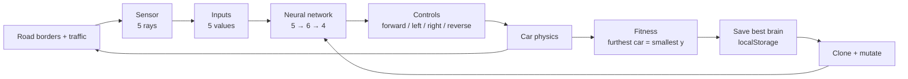

# 🚗 Neural Network Self-Driving Cars

A small self-driving car simulation written in plain JavaScript and rendered on an HTML5 `<canvas>`. A population of cars is controlled by a feed-forward neural network, and the best driver is kept and mutated to produce the next generation — no machine-learning library, no build step.

The project is inspired by the classic "AI learns to drive" neuroevolution demo: instead of training a network with backpropagation, the simulation uses **natural selection** (a simple evolutionary strategy) to improve the weights over time.

---

## Quick start

There are no dependencies to install. Either:

1. Open `index.html` directly in a browser, **or**
2. Serve the folder locally (recommended, keeps `localStorage` behaviour consistent):

```bash
npx serve .
# or
python -m http.server 8000
```

Then open the page. The left canvas shows the road and the cars, the middle column has the save/discard buttons, and the right canvas is reserved for a network visualizer.

> The simulation is CPU-heavy: 1,000 cars are updated every animation frame.

---

## How it works

At a high level, each car repeats the same loop every frame:



### 1. The world

`Road` is a straight, infinite three-lane road defined by two border segments. `Car` objects with the `"DUMMY"` control type are traffic: they always drive forward and are obstacles for the AI cars.

### 2. Sensors

Every AI car has a `Sensor` that casts **5 rays** over a **90°** field of view, each up to **150 px** long. For each ray the simulation computes the closest intersection with the road borders or a traffic car. The distance is normalized to `0…1` and then inverted:

```js
input = 1 - distance / rayLength; // 1 = nothing nearby, 0 = touching an obstacle
```

A ray that hits nothing produces `0`, i.e. "clear road ahead". These 5 values are the input vector of the network.

### 3. The brain

`NeuralNetwork` is a fully connected network with one hidden layer:

```
        inputs (5)              hidden (6)               outputs (4)

        ray 0  ─┐
        ray 1  ─┤             ●       ●
        ray 2  ─┼──────────►  ●       ●  ───────────►   forward
        ray 3  ─┤             ●       ●                 left
        ray 4  ─┘             ●       ●                 right
                                                        reverse
```

- **Architecture:** `[5, 6, 4]` (defined in `car.js` as `[this.sensor.rayCount, 6, 4]`).
- **Weights & biases:** initialized randomly in `[-1, 1]`.
- **Activation:** a binary step function. For every output neuron:

```js
sum = Σ (input[j] * weight[j][i]);
output[i] = sum > bias[i] ? 1 : 0;
```

The four outputs are wired directly to the car controls (`forward`, `left`, `right`, `reverse`). A `1` means "press", a `0` means "release".

Because there is no backpropagation, the network never computes a gradient or a loss. Learning happens purely by mutating weights and keeping what works.

### 4. Physics and fitness

`Car.#move()` applies acceleration, friction, a speed cap, and turning that scales with speed. A car is marked `damaged` when its four-point polygon intersects a road border or traffic, and damaged cars stop updating.

Since the canvas y-axis points **down** and cars drive **up**, the car with the **smallest `y`** has travelled the furthest. That car becomes `bestCar` and defines the camera position.

### 5. The evolution loop

This is the actual "learning" step:

1. On the first run all 1,000 brains are random, so most cars crash almost immediately.
2. The car that gets furthest is the best candidate of the generation.
3. Press **💾** to store its brain (weights + biases) in `localStorage`.
4. Reload the page. Every car is loaded with that saved brain; car `0` keeps an exact copy, and all other cars get a **mutated** copy.
5. Mutation moves each weight/bias a fraction of the way toward a new random value:

```js
weight = lerp(weight, Math.random() * 2 - 1, 0.1); // 10% mutation
```

6. The mutated population drives again. Some mutations are better than the original, so the best car usually beats the previous record.
7. Repeat: save → reload → mutate. Over generations the driving behaviour improves.

This is a form of **hill climbing / evolutionary strategy**, not gradient descent. It is slow and noisy, but it needs no labelled data and is easy to understand.

---

## Controls

| Control | Action |
| --- | --- |
| 💾 button | Save the current best brain to `localStorage` |
| 🗑️ button | Delete the saved brain |
| Reload page | Start a new generation from the saved brain (if any) |

`Controls` also supports a `"KEYS"` mode with the arrow keys, but `main.js` currently only creates `"AI"` and `"DUMMY"` cars, so keyboard driving is not wired up in the demo.

---

## Project structure

| File | Responsibility |
| --- | --- |
| `index.html` | Page layout, canvases, buttons, script order |
| `style.css` | Layout and canvas styling |
| `main.js` | Population setup, traffic, animation loop, save/discard, camera |
| `car.js` | Car physics, polygon collision, sensor + brain wiring, rendering |
| `sensor.js` | Ray casting and distance readings |
| `network.js` | `NeuralNetwork` and `Level` (feed-forward + mutation) |
| `road.js` | Road geometry and lane centers |
| `controls.js` | Control state; keyboard and dummy drivers |
| `utils.js` | `lerp`, segment intersection, polygon collision |

Scripts are plain globals loaded in dependency order at the bottom of `index.html`; there are no modules or bundler.

---

## Tuning

Most knobs live in a few obvious places:

| Setting | Where | Default |
| --- | --- | --- |
| Number of sensor rays | `sensor.js` → `this.rayCount` | `5` |
| Sensor range | `sensor.js` → `this.rayLength` | `150` |
| Sensor field of view | `sensor.js` → `this.raySpread` | `Math.PI / 2` |
| Network shape | `car.js` → `new NeuralNetwork([...])` | `[5, 6, 4]` |
| Population size | `main.js` → `const N` | `1000` |
| Mutation strength | `main.js` → `NeuralNetwork.mutate(..., 0.1)` | `0.1` |
| Traffic cars | `main.js` → `const traffic` | `7` |
| Lanes | `main.js` → `new Road(...)` | `3` |

Smaller populations run much faster while experimenting; 100–300 cars is usually enough to see progress.

---

## Known issues / roadmap

This is an early prototype. The following issues are present in the current code and should be fixed before training seriously:

- `utils.js` — `lerp` returns `(B - A) * t` instead of `A + (B - A) * t`, which breaks ray intersections, lane drawing, and polygon collision.
- `sensor.js` — `touches.push(push)` references an undefined variable, and `#getReading` never returns the nearest hit (it returns `null` or `undefined`).
- `network.js` — `mutate` uses `network.leves` (typo) and throws.
- `main.js` — `cars[i].brain.JSON.parse(...)` should be `cars[i].brain = JSON.parse(...)`, and `JSON.stringify(bestCar, brains)` should serialize `bestCar.brain`.
- `main.js` — AI cars are created without `maxSpeed`, so the speed cap comparisons use `undefined`.
- `main.js` — the network canvas has no `Visualizer` implementation yet, so it stays black.
- `road.js` — `strokeStyle = "while"` typo; lane dashes are set and immediately cleared.

Planned improvements:

- [ ] Fix the issues above so a full save → reload → mutate cycle works end to end.
- [ ] Implement `Visualizer.drawNetwork` to show activations and weights live.
- [ ] Move the save button logic onto `bestCar.brain`.
- [ ] Add a headless training mode / speed multiplier.
- [ ] Track and display generation and best distance.
